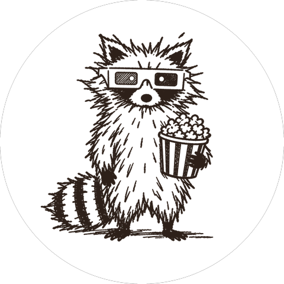

<p align="center">
  
</p>

<h1 align="center">Raton</h1>

<p align="center">
  Catalogue YouTube local : suivre des chaînes, archiver des vidéos, écouter seulement l'audio.
  0 pub, 0 trackers : seules les fonctions IA contactent des services externes.
</p>

<p align="center">
  
  
  
  
</p>

<p align="center">
  <a href="#un-mot-de-raton">Un mot de Raton</a> ·
  <a href="#02-fonctionnalités">Fonctionnalités</a> ·
  <a href="#démarrage-rapide">Démarrage rapide</a> ·
  <a href="#04-configuration-et-déploiement">Configuration</a> ·
  <a href="#développement">Développement</a> ·
  <a href="#documentation">Documentation</a>
</p>

---

<h2 align="center">Un mot de Raton</h2>

<p align="center">
  <em>Raton est là pour veiller sur tes vidéos et sur tes données.</em>
</p>

<p align="center">
  <em>Il ne veut pas que ton attention devienne la proie de plus gros prédateurs :
  algorithmes, lecture automatique, flux sans fin. Il veut que tu te fasses
  plaisir, sans te laisser engloutir.</em>
</p>

<p align="center">
  <em>Raton garde tes vidéos chez toi, t'aide à y voir plus clair dans cet océan de
  stimulation. Il surveille ton temps d'écran d'un œil bienveillant. Il ne te juge pas. Il
  compte, simplement. Et quand c'est assez, il te le dit.</em>
</p>

> [!WARNING]
> **Réseau local uniquement.** L'application n'a pas d'authentification : elle
> est conçue pour un LAN de confiance et ne doit pas être exposée sur
> Internet. Voir [15 Sécurité](docs/spec/15-securite.md).

## [02 Fonctionnalités](docs/spec/02-fonctionnalites.md)

- **Catalogue** : importer des chaînes et des playlists YouTube, ajoutées par URL ou
  depuis un Google Takeout.
- **Suivi quotidien** : deux cloches par chaîne (vidéos, shorts) qui
  récupèrent chaque nuit les nouveautés.
- **Vidéo ou audio, au choix** : téléchargement à la demande, audio ou vidéo.
- **Transcripts et IA** : résumés, notes indexées et recherche sémantique dans
  toute la bibliothèque, via une fenêtre de chat.

## [03 Architecture](docs/spec/03-architecture.md)

Python 3.14, FastAPI, Jinja2, PostgreSQL 16 + pgvector,
`yt-dlp` + `ffmpeg`, APScheduler, API Anthropic et Voyage, Docker Compose

Deux applications : `back/` (l'API JSON `/api`, la DB, les médias, les jobs)
et `front/` (les pages HTML), qui n'appelle que l'API du back. Un autre front
(application mobile, serveur MCP...) peut donc se brancher sur la même API ;
son schéma est servi par le back (`/docs`, port 8001 avec `make demo`).


## [04 Configuration et déploiement](docs/spec/04-configuration-et-deploiement.md)

La configuration passe par `.env` à partir de
`.env.example`. Sans `ANTHROPIC_API_KEY` valide, seules les fonctions IA
échouent ; le reste fonctionne. Le reste des réglages se modifie dans
`/settings`. Variables, dossier média (`MEDIA_HOST_ROOT`) et base de données.

Les médias téléchargés vivent sur ta machine, dans `./.local/media/YouTube` par
défaut. Pour utiliser un autre dossier, définis `MEDIA_HOST_ROOT` avant le lancement
dans `.env` : `MEDIA_HOST_ROOT=/chemin/vers/dossier`. Il est monté sur `/media/youtube`
dans le conteneur.

## Démarrage rapide

### Avec Docker

Prérequis : Docker avec Compose.

```bash
cp .env.example .env
make up
```

Puis ouvrir <http://127.0.0.1:8000>.

Le port `8000` n'est publié que sur la machine locale. Pour l'ouvrir à un LAN de
confiance, mettre `APP_BIND=0.0.0.0` dans `.env`.

### Désinstaller

```bash
make uninstall                          # garde la base, les médias et .env
make uninstall ARGS="--purge"           # supprime aussi la base et les logs
make uninstall ARGS="--purge-media"     # supprime aussi la bibliothèque téléchargée
```

## Avertissement

Raton est un projet personnel, sans lien avec YouTube. Il s'appuie sur
`yt-dlp` : respectez les conditions d'utilisation de YouTube et le droit d'auteur
de votre pays, et n'archivez que ce que vous avez le droit de conserver, pour un
usage privé. L'auteur décline toute responsabilité quant à l'usage qui en est fait.

## Développement

Les modifications passent par une pull request vers `main`, après `make ci`.
Le code et la spec se mettent à jour dans le même changement. Commandes : voir le
[`Makefile`](Makefile). Contribuer : [CONTRIBUTING.md](CONTRIBUTING.md) ; signaler une
faille : [SECURITY.md](SECURITY.md).

## Documentation

Le cahier des charges est sous [`docs/spec/`](docs/spec/README.md) : c'est la
référence du comportement de l'application.

## Licence

[MIT](LICENSE). Crédits des composants embarqués : [THIRD_PARTY_NOTICES.md](THIRD_PARTY_NOTICES.md).
